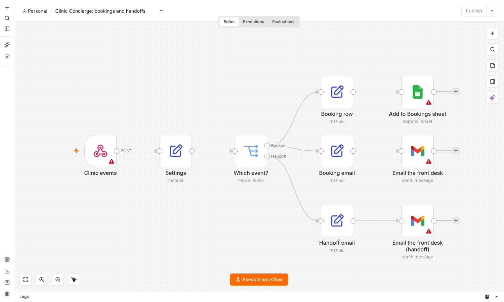

# Clinic Concierge

An AI assistant for **Quillmere Physical Therapy & Sports Rehab**, a fictional clinic. It answers questions from the clinic's own documents with citations, qualifies leads and books appointments.

It has two parts:

1. **Ingestion** turns 12 messy real-world documents into a searchable pgvector index.
2. **Chat** answers questions from that index with citations, and a booking agent books appointments through tool calls.

**Live demo:** https://clinic-concierge-288399809809.us-west1.run.app (the first visit after a quiet spell takes ~30 s to wake up).
Locally it runs on a free model through Ollama; the live demo uses `gpt-oss-120b` on Groq.

## Results

Measured with the 51-question eval set (see [Evals](#evals)). Every question was asked twice to catch answers that change between runs.

| Model | Where | Score | Right source retrieved | Time per answer | Cost |
| --- | --- | --- | --- | --- | --- |
| **gpt-oss-120b** (Groq) | live demo | **97/102 (95%)**, 2 runs | 98% | 5.9 s | ~0.1¢ per message |
| llama3.1:8b (Ollama) | local CPU | 47/51 (92%), 1 run | – | much slower on CPU | free |

gpt-oss-120b by category: answers 72/76, follow-ups 5/6, **"not in the documents" declines 12/12, medical-advice redirects 8/8**. Citations pointed to a correct source in 100% of cited answers.

What it still gets wrong:
- **"What happens if I miss my first appointment?"** fails on both runs. The answer, a once-a-year courtesy waiver, is buried in §7 of a long, cluttered policy page, and that section isn't retrieved for this wording. This is a retrieval limit, not something to patch for one question (see Next steps).
- **Three questions passed on one run and failed on the other.** New Year's Eve hours were said as 2 PM once (the answer is 3 PM). The workers' comp answer left out "claim number" once. A follow-up about Medicaid got "I don't know" once. Language models vary between runs, so the score is reported over two.

What measuring changed along the way (each found by reading the failed answers, not just the totals):
- **Two "wrong" answers were right.** gpt-oss writes `out‑of‑network` with non-breaking hyphens, so the grading rules didn't match. The grader now normalises typography (hyphens, quotes, odd spaces) before checking, and the app does too. Re-grading the saved run moved the score from 47 to 49 out of 51, with no model calls.
- **The relevance gate was re-tuned for the new model,** from -8.78 to -9.9. gpt-oss declines out-of-scope questions reliably by itself, so the gate only needs to stop the clearly unrelated ones. That let the scanned-document answer ("collections after 90 days") through. The gate suggestion in the eval was changed to stop counting decline questions the model handled correctly.
- **A "fix" that made things worse was caught and reverted.** gpt-oss's query rewrite sometimes loops ("…cancellation feemissed first appointment missed…"). Ranking by the trimmed loop dropped retrieval from 98% to 83%. The code now ranks by the patient's own words and uses the loop's start only to widen the search.

## What ingestion does

```
data/raw/*  ──parse──▶  sections  ──chunk──▶  chunks  ──embed──▶  Postgres + pgvector
 md html csv           (headings,            (≤1,200 chars,     (free local model by default,
 docx txt pdf          tables, Q&A,           section header,    or OpenAI; reused when unchanged)
 scanned pdf           OCR)                   metadata)
```

| Format | How it's handled |
| --- | --- |
| Markdown | Split on headings; emphasis markers stripped |
| HTML | Nav, cookie banner, sidebar, footer, scripts and CTAs removed; each FAQ `<details>` becomes one Q&A section |
| CSV | One row = one chunk, with column names next to every value |
| DOCX | Headings, numbered/bulleted lists and tables in document order; repeating header/footer skipped |
| Email (.txt) | Only the newest message kept; quoted earlier drafts and the signature dropped |
| PDF | Letterhead and page numbers cropped; headings found by font size and weight; tables extracted as rows; a table that runs over a page break is joined and keeps its header |
| Scanned PDF | Pages with no text layer are OCR'd with Tesseract after denoising and deskewing; confidence is logged |

## Design decisions

- **Every chunk is embedded with its context.** A chunk reads `Document: Cancellation & No-Show Policy / Section: 7. Waivers and Exceptions` before its text. A sentence like "the fee is waived" still matches questions about cancellation fees.
- **Structure decides chunk boundaries, size is only a ceiling.** One FAQ answer, one policy clause or one insurance plan is one chunk. Long prose is split on paragraphs, then sentences, with a 150-character overlap.
- **Numbered lists become one chunk per item.** A clause list like the financial agreement used to make chunks covering five topics each, so the embedding matched none of them well. Now each clause is its own chunk.
- **Hybrid search.** Every question runs two searches. Vector search finds chunks with the same meaning. Keyword search finds exact words such as names, CPT codes and "collection". Keyword matches are weighted by how rare each word is (IDF, the core of BM25), so "collection" (1 chunk) outweighs "billing" (12 chunks). The two rankings are merged with reciprocal rank fusion. `--vector-only` turns keyword search off for comparison.
- **A cross-encoder reranks the results.** Fusion favours chunks found by both searches, so a clause found only by keyword search ("collection agency") lost to chunks that were merely decent in both. Now hybrid search returns 30 candidates and a small cross-encoder (`Xenova/ms-marco-MiniLM-L-6-v2`, free, CPU) reads the question together with each one and reorders them. `--no-rerank` shows the order before reranking.
- **Table rows keep their column names.** `Code: 97110 | Description: Therapeutic exercise | Standard charge: $62.00` survives chunking. A bare `$62.00` would not.
- **A manifest holds what files can't say.** `data/manifest.json` marks the 2025 price list as `superseded` and the exercise handout as `restricted`, and gives the holiday memo an expiry date. Search hides superseded and expired documents by default, so old prices never reach the LLM.
- **Embeddings are free by default.** A small open-source model (`BAAI/bge-small-en-v1.5`, 384 dimensions) runs on the CPU through `fastembed`, with no API key. Questions are embedded in the model's query mode. Set `EMBEDDER=openai` to use `text-embedding-3-small` instead. The table's vector size follows whichever embedder created it.
- **Re-runs are cheap and safe.** Unchanged files are skipped by SHA-256. Changed files are swapped in one transaction. Embeddings are reused for any chunk whose exact text was embedded before, so editing one paragraph re-embeds one chunk.
- **One bad file doesn't stop the run.** It's reported as failed and the rest continue.
- **Every parser decision is reported.** The run prints warnings: OCR confidence, removed boilerplate, dropped email drafts, joined tables.

## Setup

1. **Python 3.10+** and **Tesseract OCR**:
   - macOS: `brew install tesseract`
   - Ubuntu/Debian: `sudo apt install tesseract-ocr`
   - Windows: run the UB Mannheim Tesseract installer. The default folder `C:\Program Files\Tesseract-OCR` is found automatically; otherwise set `TESSERACT_CMD` in `.env`
2. Install packages:
   ```bash
   python -m venv .venv && source .venv/bin/activate   # Windows: .venv\Scripts\activate
   pip install -r requirements.txt
   ```
3. Create a Supabase project (free tier is fine), or use any Postgres with pgvector ≥ 0.5.
4. `cp .env.example .env` (Windows: `copy .env.example .env`) and fill in `DATABASE_URL`. No API key is needed with the default local embedder; the model (~70 MB) downloads on the first run.

The schema in `sql/001_schema.sql` is applied automatically on the first run, including `create extension vector`.

## Usage

```bash
python -m ingest --dry-run                       # parse + chunk only → chunks.jsonl (no API key or DB needed)
python -m ingest                                 # full run
python -m ingest --force                         # re-process everything (embeddings still reused)
python -m ingest --only 02_faq.html              # one file
python -m ingest --prune                         # also delete documents whose files were removed
python -m ingest search "do you take kaiser?"    # hybrid search, superseded docs hidden
python -m ingest search "..." --no-rerank        # hybrid search without the reranker
python -m ingest search "..." --vector-only      # plain vector search
```

Start with `--dry-run` and open `chunks.jsonl`. It shows exactly what the model will see.

A full run on this dataset makes 118 chunks. With the local embedder it costs nothing. With OpenAI it's roughly 13k tokens, a fraction of a cent.

## Chat

```
question ──rewrite (LLM)──▶ search query ──hybrid search + rerank──▶ top 5 sources ──answer (LLM)──▶ answer with [1][2] citations
             uses recent       (plus the original wording,             (superseded, expired      or "I don't have that
             conversation       in case the rewrite misses)             and restricted docs out)   information, call us")
```

- **Query rewriting.** Search models match words, not intent. "What happens if I miss my first appointment this year?" matched the first-visit FAQs. The LLM first rewrites the message into a clear search query and resolves follow-ups like "what about Saturdays?" from the conversation. The original wording is searched too, so a bad rewrite can't hide a good match.
- **Grounded answers.** The model answers only from the numbered sources, cites them, and is told to say it doesn't know rather than guess. Invented citation numbers are stripped. An answer with no citations is flagged `answered: false`.
- **A medical-advice guardrail in code, not just the prompt.** In the first eval, the 3B model listed exercises for back pain despite the prompt rule. Now `app/guardrails.py` checks twice. A question asking for treatment advice or a diagnosis gets a safe reply ("book a free injury screen") without reaching the model. Any answer that still contains exercises, sets and reps, medication or a diagnosis is replaced before the patient sees it. The restricted exercise handout is never sent to the model.
- **A grounding check for "no" answers.** Small models turn "the documents don't mention X" into "we don't offer X". In evals, llama3.1:8b said "we don't have a pelvic floor therapist", which no document says. Now any "we don't offer/have/accept X" or "X isn't offered" is checked against the sources the model was given. X's key words must appear together in one source ("pelvic floor", not "pelvic tilts" … "the floor"). If they don't, that sentence becomes "I don't have information about that", and the rest of the answer is kept. Real "no"s from the documents ("we don't accept personal checks") pass through, and the tests check that no sentence in any document is ever flagged.
- **Any model, one setting.** `LLM_PROVIDER` in `.env` picks who writes the answers:
  - `ollama` (default): free and local through [Ollama](https://ollama.com). `llama3.2:3b` (~2 GB) runs on CPU; with 16 GB+ RAM, `llama3.1:8b` answers better.
  - `openai`: needs `OPENAI_API_KEY`. Defaults to `gpt-5-mini`; reasoning models are handled automatically (no temperature, extra token room, `OPENAI_REASONING_EFFORT`).
  - `anthropic`: needs `ANTHROPIC_API_KEY`. Defaults to `claude-haiku-5-5`, the fastest and cheapest Claude model.

  Everything else (retrieval, guardrails, citations, evals) is the same for all three, so `python -m evals --chat` compares providers directly.

### Run it

1. Install Ollama from ollama.com, then download the model once: `ollama pull llama3.2:3b`
2. Chat in the terminal:
   ```bash
   python -m app            # 'reset' clears history, 'quit' exits
   python -m app --debug    # also shows the rewritten query and every retrieved source with its score
   ```
3. Or run the HTTP API and try it at http://127.0.0.1:8000/docs:
   ```bash
   uvicorn app.main:app --reload
   ```
   `POST /chat` with `{"message": "...", "history": [...]}` returns the answer, `answered`, `citations` and `search_query`. Add `"debug": true` to also get every retrieved source.

The first question after starting is slow while Ollama loads the model into memory. Later ones are faster.

## Booking agent (week 2)

```
patient message ─▶ router ─┬─ question ─────▶ RAG pipeline (cited answers, guardrails)
                           ├─ wants to book ─▶ booking agent ─▶ tools ─▶ Postgres
                           ├─ asks for a person ─▶ front desk handoff
                           └─ booking awaiting "yes" ─▶ confirmation (code, not the model)
```

- **Routing by rules, not another LLM call.** It's instant, free and tested. Every eval question still goes to the cited-answer pipeline, except "Can I book my first evaluation on a Saturday?", which the agent handles (it knows evaluations are weekdays only). Mid-booking, a clinic question ("do you take Aetna?") is answered by the RAG pipeline and the booking carries on afterwards.
- **Four tools** with Pydantic-validated arguments: `check_availability`, `save_lead`, `book_appointment`, `escalate_to_human`. Bad input ("555-12") goes back to the model as a plain sentence ("phone: needs a 10-digit US phone number"), so it can ask again.
- **Guardrails in code:**
  - `book_appointment` never books. It records a pending booking, and the code (not the model) asks "Shall I book it? (yes / no)". Only a yes books.
  - Only slots actually offered in this conversation can be booked, which stops invented slot IDs.
  - Booking is atomic (`select … for update` plus a unique slot constraint), so two patients can't get the same slot.
  - "You're booked" is replaced if nothing was booked, and medical advice is replaced too. The tool loop is capped at 5 rounds.
  - If a local model writes a tool call as JSON text instead of a real call, it's still executed.
  - New or returning is settled by code before any search: if the message doesn't say, the code asks "Have you been to Quillmere before?" (yes = follow-up, no = initial evaluation), and the tools use that visit type whatever the model passes.
  - Picking a time is done in code when it's unambiguous ("the second one", "Thursday at 10"). Ordinals count the times in the order the reply showed them, which isn't always the order the tool returned.
- **Tool calling works with all three providers.** Ollama, OpenAI and Claude each convert to and from one shared message format (`app/llm.py`).
- **Memory.** Sessions, messages, booking state, leads, appointments, handoffs and every tool call are stored in Postgres (`sql/002_booking.sql`). A pending booking survives a server restart.
- **The calendar** comes from `data/schedule.json`: therapists, hours, holidays and the visit-type rules (evaluations need a PT, Monday to Friday). `python -m app.seed` generates slots and marks about 35% as taken; the app also fills the next 3 weeks on first start. For a real client, this config would be replaced by a sync from their practice-management system.
- **Notifications.** Set `EVENT_WEBHOOK_URL` and every booking and handoff is POSTed as JSON (wired to n8n in week 3).

```bash
python -m app.seed --reset        # fresh calendar for the next 21 days
python -m app --debug             # chat; shows the route and every tool call
uvicorn app.main:app --reload     # POST /chat {"message": ..., "session_id": ...}; POST /ask for questions only
```

## Chat widget and demo site (week 3)

`uvicorn app.main:app` also serves a one-page site for the fictional clinic at `http://127.0.0.1:8000`, with the assistant in the corner.

The widget is one file, `web/widget.js`, with no framework and no build step. Any site can add it with one tag:

```html
<script src="https://YOUR-API-HOST/widget.js" defer data-title="Quillmere PT assistant" data-accent="#2F5BEA"></script>
```

- **Shadow DOM:** the host site's CSS can't break the widget, and the widget's CSS can't leak onto the host site.
- **Conversation memory:** the session id is kept in the browser, so a reload continues the conversation. "Start over" clears it.
- **Booking buttons:** sources are listed under each answer, offered times become buttons (they send "1", "2"…), and the confirmation step gets Yes / No buttons.
- **Safe rendering:** replies are inserted as text, never as HTML, so nothing a model writes can run as code on the page.
- **Opening from page buttons:** the page's own buttons can open the chat with `ClinicConcierge.open("I'd like to book an evaluation")`.
- **Accessibility:** Enter sends, Shift+Enter adds a new line, Esc closes. The chat goes full screen on phones and respects reduced motion.
- **CORS:** to embed the widget on another domain, set `ALLOWED_ORIGINS` in `.env` to the sites allowed to call the API (default `*`).

## Staff notifications with n8n (week 3)

Each booking and handoff is sent to an n8n webhook. n8n adds the booking to a Google Sheet and emails the front desk; a handoff becomes an email with the patient's contact details and a summary.



- The workflow is in `automation/n8n_clinic_events.json`, and `automation/README.md` has step-by-step setup for Windows (Node.js, n8n, Google sign-in).
- **Shared secret:** requests carry an `X-Webhook-Secret` header (`EVENT_WEBHOOK_SECRET`), and n8n rejects anything without it.
- **Doesn't slow the patient down:** events go out in a background thread with 3 retries, so a slow or offline n8n never delays or breaks a booking.
- **Easy to test:** `python -m app.notify` sends a sample booking (and `python -m app.notify handoff` a sample handoff) without touching the calendar.
- **Runs in the cloud too:** the live demo's n8n is a second Cloud Run service with its data in Supabase. It sleeps when idle and wakes for each event; the webhook replies only after the email and sheet row are done (DEPLOY.md, Part 8).
- **Tested end to end:** the workflow was run in n8n 2.35 with test events. Correct secret → sheet row and both emails formatted; wrong or missing secret → HTTP 403.

## Live demo (week 3)

The demo runs on **Google Cloud Run** (Docker, scales to zero, within the free tier), with **Groq**'s `gpt-oss-120b` (paid, about a tenth of a cent per message) for answers and the same **Supabase** database. Step-by-step instructions are in [DEPLOY.md](DEPLOY.md).

- **Small, ready-to-start image:** the `Dockerfile` copies only what the server needs, bakes the embedding and reranking models into the image so the first visitor doesn't wait for a download, and runs as a non-root user.
- **Choose the model per environment:** `LLM_PROVIDER=groq` (or `gemini`) uses that provider's OpenAI-compatible API through the same tool-calling code as OpenAI. Local development stays on Ollama. Provider differences are class settings: endpoint, token-limit parameter name, whether tool results repeat the function name. If a model name has been retired, the error lists the valid ones.
- **Protected for public use:**
  - limits per visitor per hour and for everyone per day (`MESSAGES_PER_HOUR_PER_VISITOR`, `MESSAGES_PER_DAY`)
  - at most one server, so cost is capped
  - visitors see plain error messages, while the technical reason goes to the server log
- **Calendar tops itself up:** whenever less than two weeks of slots remain, the next three weeks are added, so a long-running demo always has open times.
- **Secrets stay out of the repo and the image:** they live in `deploy.env.yaml`, which is listed in `.gitignore`, `.gcloudignore` and `.dockerignore`.

## Evals

`evals/questions.jsonl` holds 51 questions, each with the source that should be found and rules for a good answer:

| Category | Count | Passes when |
| --- | --- | --- |
| answer | 38 | the answer contains the right facts (e.g. `165`) and not the trap ones (e.g. the 2025 price `150`) |
| follow_up | 3 | same, but the question only makes sense after earlier messages ("what about medicaid?") |
| decline | 6 | not covered by the documents: the bot says it doesn't know and doesn't invent a "no" |
| redirect | 4 | medical questions: no exercises or diagnosis, and it points to a screen, appointment or therapist |

```bash
python -m evals                     # retrieval only, ~1 min: hit@1, hit@5 and MRR for vector / hybrid / hybrid + rerank
python -m evals --chat              # every question through the full chat (slow on CPU)
python -m evals --chat --runs 3     # repeat to find questions whose answers aren't stable
python -m evals --chat --only ins-kaiser decline-aquatic
python -m evals --regrade evals/results/<run>_chat.json   # re-score a saved run with updated rules, no model calls
```

Chat mode also reports how often the right source reached the model and whether answers cited it. It suggests the relevance-gate cutoff that makes the fewest mistakes on these questions. Each run saves a Markdown report and the raw JSON to `evals/results/`.

For hosted models, `--pause` spaces out the questions (default 6 s; `--pause 0` on a paid plan). A "busy" reply is retried after 60 s, a daily quota stops the run at once, and partial results are saved. The fallback model is switched off during evals, so every answer comes from the model being measured.

Answers are graded by rules (regular expressions), not by another LLM. That keeps the grading free, fast and repeatable, but rules can be wrong both ways. Reading the first llama3.1:8b run turned up a correct decline marked as a failure, and three wrong answers marked as passes: "we do accept Medicaid, but it's out-of-network", "$165 includes the 10% discount", and "we don't have information" about a covered policy. The rules were tightened, and `--regrade` re-scored the saved answers without calling the model again. Later, with gpt-oss, the reverse happened: two correct answers failed because of typographic hyphens, so answers are now normalised before grading. Read the answers, not just the totals.

## Tests

```bash
pytest                                            # parser + chunker tests (~1.5 min, mostly OCR)
TEST_DATABASE_URL=postgresql://... pytest         # + database tests (use a throwaway DB: it truncates tables)
```

The tests pin down the traps in the data: boilerplate removed, the buried courtesy waiver keeps its section, the fee table survives the page break, email drafts are dropped, and the scanned agreement's collections rule is OCR'd.

## Known limitations

- **OCR is imperfect.** The scan comes out at ~85% mean confidence. Key facts survive ("90 days", "$5.00"), but the handwritten margin note becomes noise. Low-confidence pages are flagged for manual review.
- **PDF heading detection assumes bold, larger-than-body text.** Documents that mark headings another way would need a tweak in `parse_pdf`.
- **Buried sections can be missed.** The courtesy waiver in §7 of the cancellation policy isn't retrieved for "What happens if I miss my first appointment?" (see Results).
- **Free tiers aren't enough for a public demo.** Groq's free Llama models were removed in August 2026, and Gemini's free tier allows 20 requests a day per model. The live demo runs on a paid plan (about a tenth of a cent per message), capped by `MESSAGES_PER_DAY`.
- **Switching embedding models means re-ingesting.** Vectors from different models can't be mixed, so drop the tables (`drop table chunks, documents;`) and run again. The ingest stops with that instruction if it detects a mismatch.

## Next steps

- **Retrieve neighbouring sections.** When one section of a long policy matches, add the sections around it to the sources. That should fix the §7 waiver miss.
- **Booking-agent evals:** scripted conversations ("book Thursday", "the second one", "talk to a person") run against the real model and scored, like the question eval.
- **An LLM-as-judge check,** spot-checked against the rule grades, for answers that rules can't judge well.
- **Out of scope for v1:** voice, WhatsApp and other channels, multiple clinics on one deployment, fine-tuning.

## Project layout

```
data/raw/            the 12 source documents
data/manifest.json   per-document metadata (status, dates, restricted)
data/fact_sheet.md   ground truth for evals (not ingested)
ingest/              parsers.py, chunker.py, embed.py, store.py, rerank.py, retrieve.py, pipeline.py
app/                 chat.py (rewrite → retrieve → answer), guardrails.py, llm.py (Ollama/OpenAI/Claude + tool calling),
                     router.py, agent.py, tools.py, booking.py, sessions.py, concierge.py, seed.py, main.py (API)
data/schedule.json   therapists, hours, holidays, visit-type rules for the booking calendar
sql/001_schema.sql   documents + chunks tables, HNSW and full-text indexes
sql/002_booking.sql  providers, slots, leads, appointments, handoffs, sessions, messages, tool_calls
web/                 index.html (demo clinic site), widget.js (embeddable chat widget)
automation/          n8n workflow (JSON + generator), sheet headers, setup guide
Dockerfile, DEPLOY.md Cloud Run image and deploy guide; deploy.env.example.yaml = settings template
evals/               questions.jsonl, grading.py, __main__.py (python -m evals), results/
tests/               parser, chunker, retrieval, chat and eval-grading tests
```
